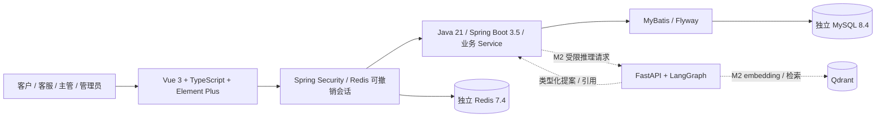
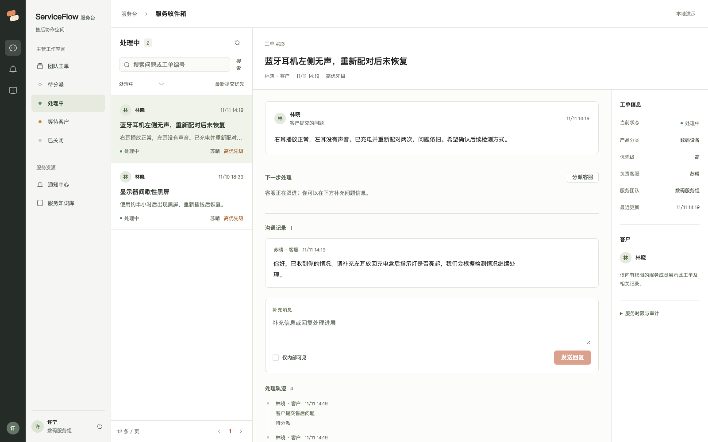
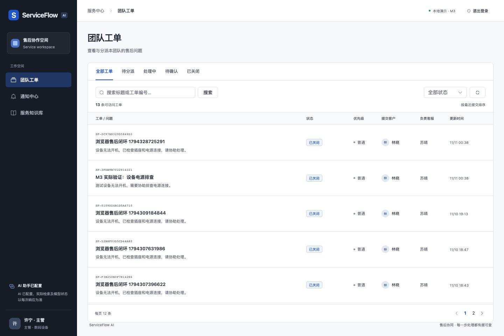
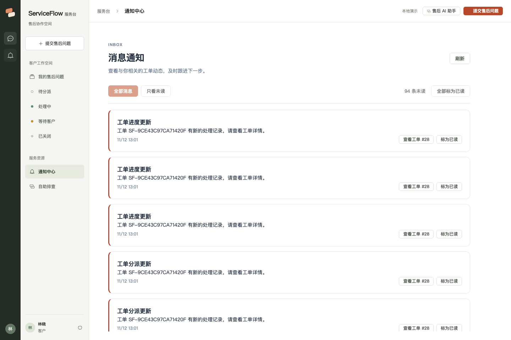

# ServiceFlow AI · 智能售后工单协同平台

面向 Java 后端 + AI 应用工程实习的独立作品：客户提出售后问题，主管分派，客服处理并提交解决方案，客户确认后关闭。以可验证的数据权限、状态机与并发一致性作为业务基础。

**当前交付版本：v0.9.0。** M1–M4 的工单、协作运营、AI 服务及容器演示已经实现，后续补齐了客服工作台、分页通知、账号改密、知识审核工作台、受控知识发布及索引核验恢复和SLA风险队列。已接入 FastAPI/LangGraph、真实本地多语言 Embedding/Qdrant、来源引用、受约束工具提案、客户确认和 Java 幂等执行。没有 LLM Key 时为 `retrieval_only`，只返回真实检索原文，不生成提案；远端 LLM 质量尚未实测。当前仅用于本地演示，没有生产部署。

[](https://github.com/GavinLau14/serviceflow-ai/actions/workflows/ci.yml)

[版本历史](CHANGELOG.md) · [业务模块与源码导航](docs/MODULES.md) · [版本与分支管理](docs/GITHUB_WORKFLOW.md) · [演示路线](docs/DEMO.md) · [源码与面试讲解](docs/INTERVIEW_GUIDE.md) · [验收任务](docs/TASKS.md)

## 业务模块

| 模块 | 已实现的业务能力 |
| --- | --- |
| 账号与权限 | 四类角色与数据范围、可撤销会话、本人改密、凭据版本使旧会话失效 |
| 售后工单 | 建单、分派、处理、公开回复/内部备注、客户确认关闭、版本冲突检查 |
| AI 售后助手 | 意图与字段合同、真实语义检索、来源引用、待确认工具草稿、幂等执行/人工接管 |
| 运营协作 | 同组最小负载自动分派、SLA 扫描升级、客户等待时长补偿、权限风险队列、事务审计与通知 outbox |
| 通知收件箱 | 本人通知分页、未读筛选、全量未读计数、显式批量已读 |
| 索引运营 | 管理员分页状态面板、真实向量核验、缺失停止引用、同版本显式修复及修复审计 |
| 知识沉淀 | 待审核队列、分页与文本检索、来源与审核人、退回理由和不可覆盖的审核记录；审核通过不自动发布，管理员独立脱敏授权后进入真实向量检索，支持版本替换与撤回 |

源码、接口、测试和面试阅读顺序见 [模块导航](docs/MODULES.md)。

## 架构



Java 是唯一业务写入方。Python 不持有业务数据库凭据；所有工具写入都必须由 Java 校验身份、数据范围、显式授权、版本和幂等性。设计取舍见 [ADR](docs/adr/0001-business-and-ai-boundary.md)。四个参考项目的实际审阅结果、许可证和固定提交见 [技术评估](docs/REFERENCE_REVIEW.md) 与 [第三方记录](THIRD_PARTY_NOTICES.md)，未直接复制其源码。

## 环境与隔离

- JDK 21、Maven 3.9+、Node 22.12+（本机验证为 Node 24）、Docker Compose v2，Python 3.9+ 仅用于本地演示/验证脚本。
- Python AI 服务使用 3.12，M2 需安装下述锁定依赖。
- Compose 项目名 `serviceflow`；MySQL 数据库 `serviceflow` / 测试 `serviceflow_test`。
- 业务 MySQL `127.0.0.1:13318`、Redis `16389`；测试 MySQL `13319`、Redis `16390`；API `18081`、前端 `15173`。
- 服务仅监听本机，卷与容器独立于其他项目。不使用已有 ProcureGuard 数据库或服务。

## 一键容器启动（推荐演示）

```bash
git clone https://github.com/GavinLau14/serviceflow-ai.git
cd serviceflow-ai
./scripts/stack-up.sh
# 浏览器 http://127.0.0.1:18080
python3 scripts/smoke-stack.py --with-ai
```

需要Docker Compose v2、Bash和Python 3.9+（初始化与演示脚本使用）；Java、前端和Python服务从源码构建镜像，不需要本机JDK、Node或Python 3.12虚拟环境。初次下载依赖和真实模型需要联网。[部署与故障恢复手册](docs/DEPLOYMENT.md) · [演示路线](docs/DEMO.md) · [架构](docs/ARCHITECTURE.md) · [M4验证](docs/M4_RESULTS.md)。

## 本机开发启动

在本仓库根目录执行：

```bash
./scripts/init-local.sh
# 随机生成本地 .env，已有文件不会覆盖；不要提交或共享该文件。
docker compose up -d --wait mysql redis
./scripts/run-api.sh
```

另一个终端：

```bash
npm --prefix frontend ci
npm --prefix frontend run dev
```

打开 [工作台](http://127.0.0.1:15173)。健康检查 [API health](http://127.0.0.1:18081/actuator/health)。初次运行会在显式启用 demo 的脚本下创建演示用户；正常应用默认不播种账号。业务表由 Flyway 迁移，禁止自动 DDL。

| 账号 | 角色 | 数据范围 |
|---|---|---|
| alice / bob | 客户 | 各自提交的工单 |
| agent | 数码组客服 | 分派给自己的工单 |
| supervisor | 数码组主管 | 数码组全部工单 |
| otheragent / otherlead | 家电组客服 / 主管 | 对应家电组范围 |
| admin | 管理员 | 全部工单；仍不能替客户确认解决 |

演示账号共用本地 `.env` 中 `SERVICEFLOW_DEMO_PASSWORD`；页面不预填密码。本项目不附带真实服务凭据。修改该变量不会重写已存在账号的密码散列；演示库首次初始化后应保留原配置。

可选演示数据（API 已启动后）：

```bash
set -a
source .env
set +a
python3 scripts/seed-demo.py
```

脚本经 Java REST API 创建 5 张不同状态的售后工单，匹配标题已存在时跳过；仅用于演示，不作为正式导入接口。

## 服务收件箱前端改版

前端现为工具栏、工作队列、持久工单列表和案件上下文布局，沟通/回复先于系统轨迹。登录页、手机返回/退出、通知入口和工单属性同步调整。GitHub参考与许可证边界见docs/FRONTEND_REFERENCE_REVIEW.md；没有复制上游源码或资产。



使用容器后端开发前端时，可在本地.env设置SERVICEFLOW_PROXY_TARGET=http://127.0.0.1:18080；未设置时仍使用18081本机Java。原有里程碑记录保留，当前前端验证见docs/FRONTEND_REDESIGN_RESULTS.md。

## M3 协作运营与新版工作台

工单队列与处理区协同，提供通知中心和知识库。客户可在 AI 结果中显式选择服务分类并确认转人工；系统按同组最小有效负载自动分派。主管可查看 SLA/审计并审核关闭工单形成的知识草稿。定时任务默认每30秒检查时限及投递站内通知。

通知支持服务端分页、只看未读、全量未读计数，以及确认后将本人全部通知标为已读；管理员也不能标记他人的消息。新接口与边界见 [通知收件箱 API](docs/API.md#通知收件箱m3-增补)。

[M3 验证记录](docs/M3_RESULTS.md) / [M3 API](docs/M3_API.md)



## M2 启动与模型配置

```bash
./scripts/init-local.sh   # 保留旧值，仅补充缺失的内部 AI token
# 在本地 .env 增加 SERVICEFLOW_AI_ENABLED=true
python3.12 -m venv ai-service/.venv
ai-service/.venv/bin/pip install -r ai-service/requirements.lock
docker compose --profile ai up -d qdrant
./scripts/run-ai.sh
```

Java 在新终端运行 `./scripts/run-api.sh`（如果原服务仍在运行，先 Ctrl+C）。管理员 `admin` 在工作台点击“更新演示知识库索引”，首次会下载约240MB真实模型；随后客户打开“售后 AI 助手”，输入“空调不制冷需要维修”，可看到真实语义检索及引用。Qdrant 端口16333、Python18082均独立于其他项目。演示知识是虚构资料，不代表真实品牌政策。

`run-ai.sh` 读取同一 `.env`，将 SERVICEFLOW_AI_SERVICE_TOKEN 映射到内部 AI_SERVICE_TOKEN。远端生成可选配置：AI_LLM_API_KEY、AI_LLM_BASE_URL、AI_LLM_MODEL；不把 Key 写入源码或聊天。未配置时不会用规则或模拟向量冒充模型。

真实模型配置后可执行六场景验收：`python3 scripts/llm_acceptance.py --run-live --output work/llm-acceptance.json`。它通过 Java API 验证引用、两类报修草稿、咨询不建单、政策追问和越权诱导，不执行工单提案。未就绪退出码为 2，不能记为通过。配置步骤、检查标准及局限见 [真实模型验收](docs/LLM_ACCEPTANCE.md)。

本地默认阈值0.45只适用于当前三条演示资料，尚未通过业务评测校准。生成回答采用保守的引用原文约束。AI 只生成待确认草稿，执行时 Java 校验本人、确认、30分钟有效期并锁行，重复请求只产生一张工单。[M2 API](docs/M2_API.md) / [M2 实际验证](docs/M2_RESULTS.md)。

## 演示路径

1. `alice` 提交数码设备问题，查看待分派状态。
2. `supervisor` 打开工单，选择 `agent`，勾选确认并分派。
3. `agent` 开始处理，可回复或添加客户不可见的内部备注；填写实际解决方案后提交。
4. `alice` 阅读轨迹，可选择“仍未解决”退回；问题解决后显式确认并关闭。
5. 使用 `bob`、`otheragent` 验证无法访问这张工单；`admin` 可查看全局，但不能替客户关闭。

状态：`OPEN → ASSIGNED → IN_PROGRESS → WAITING_CUSTOMER → CLOSED`，客户拒绝返回 `IN_PROGRESS`。并发更新基于 version 比较，过期请求返回 409。每次成功流转与业务数据在同一事务提交。

## 测试与构建

```bash
./scripts/test.sh
# 独立测试 MySQL/Redis → mvn verify → npm ci → 类型检查 + Vite build
```

浏览器测试需业务 API 与 Vite 正在运行：

```bash
set -a
source .env
set +a
cd frontend
npx playwright install chromium
npm run test:e2e
```

`WorkflowIntegrationTest` 验证角色/团队/内部备注、状态流转与版本冲突；`ConcurrentUpdateTest` 检查并发版本更新；`LoginRateLimitTest` 验证分钟边界；`PasswordChangeIntegrationTest` 验证改密、并发和回滚；`KnowledgeInboxIntegrationTest` 与 `KnowledgeReviewConcurrencyTest` 验证知识权限、历史分页及双人审核防覆盖。无 H2 替代，无测试覆盖率宣称。最新本地验证为 Java 101 项、Python 40 项（含真实 Embedding/Qdrant）、浏览器 39 项，详见 [SLA 风险工作台验证](docs/SLA_WORKBENCH_RESULTS.md)。远程构建以 [GitHub Actions 实际运行](https://github.com/GavinLau14/serviceflow-ai/actions) 为准；历史报告中的“未推送”是当时状态。

## 演示截图




## 目录

```text
backend/       auth / ticket / ai / operations / collaboration，MyBatis、Flyway、JUnit
frontend/      Vue 工作台、API 类型、组件、Playwright 业务闭环
ai-service/    FastAPI/LangGraph、模型适配器、真实向量检索、pytest/lockfile
scripts/       本地配置、API 启动、测试、幂等演示数据
infra/         Java / Python / Web Dockerfile、Nginx、Maven 镜像构建设置
compose.yaml   完整应用与独立 MySQL / Redis / Qdrant、测试服务
.github/       CI 配置
docs/         上游评估、设计、接口、ADR、里程碑验证、任务清单
```

[REST API 文档](docs/API.md) 包含请求、权限、错误码与 curl 示例。M1 暂用手写文档，OpenAPI 导出为后续工作。

项目 `.npmrc` 使用仓库内 `.cache/npm`，避免依赖本机全局 npm 缓存权限。该缓存不提交。

## 当前局限

- M2 已验证真实本地 Embedding/Qdrant；没有配置远端 LLM Key，真实生成/工具调用的远端验收尚待完成。仅有三条演示知识，不能代表生产问答质量。已实现规则自动分派、SLA升级、站内通知outbox、内部审计查询和人工审核知识沉淀。审计不具备数据库管理员防篡改保证。
- 已支持本人修改密码（左下角头像进入账号安全），尚无自助注册、忘记密码找回/管理员重置、附件、实时聊天、退款执行、多租户、客户组织结构；团队由产品分类固定映射。
- 本地 bearer 存 sessionStorage；生产需独立评估 XSS/CSP、HTTPS、SSO、密钥管理及备份。Redis 当前只绑定本机，未配置生产认证/集群，不能直接暴露公网。
- 登录按源地址每分钟限流；代理地址信任、共享出口与多实例运维仍需设计。没有压测、渗透测试或完整依赖安全审计结论。
- Compose stack profile 已覆盖 Java/前端/Python/MySQL/Redis/Qdrant；配置用于本地演示，不代表生产部署。
- Flyway 11.7.2 实际迁移通过，但对 MySQL 8.4 输出“版本未正式测试”警告；正式部署前应升级核验兼容版本。JDK 测试输出包含 Mockito 动态 agent 警告，未影响结果。

停止本地 API/前端可在对应终端 Ctrl+C；`docker compose --profile test stop` 只停止本项目容器并保留业务卷。不要使用 `down -v`，除非确实要销毁本项目演示数据。
