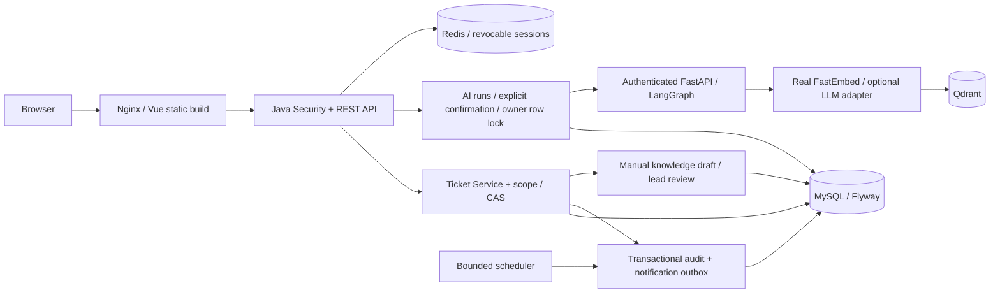

# ServiceFlow architecture

业务写入都经Java。Python不接收MySQL账号或客户令牌，不能靠模型声称的角色写入数据库。知识PUBLISHED与AI语料发布分离；当前Qdrant只索引三条明确演示知识。

默认容器网络：web:80→api:18081→ai-service:18082→qdrant:6333；api连接mysql:3306和redis:6379。宿主仅新增web18080环回端口，开发基础设施仍保留各自环回映射。所有源码镜像构建均排除.env和宿主缓存。

## 一致性边界

- 普通工单修改：数据范围读取→version CAS→同事务事件/审计/outbox。
- 自动分派：先锁团队再INSERT，锁定当前负载防止老快照超分派；无容量保留待分派。
- AI执行/接管：同一个ai_runs owner行锁保护ticketId，工单创建和回写同事务，重复请求返回同一工单。
- 通知：outbox_id唯一，扫描器去重投递站内通知；不是对任意外部渠道的exactly-once承诺。
- SLA：注入Clock的UTC期限，超时标记只置一次；等待客户不升级解决超时，不累计补偿等待时长。
- 知识：关闭状态、范围校验、人工脱敏确认、主管/管理员审核，当前活跃草稿唯一。

## 可观测与限制

API health监测依赖，AI health区分进程可达/语料ready/LLM配置；每个AI结果返回实际模式，禁用/服务故障不能被写成成功工单。AI调用记录包含响应、原文/哈希和耗时，保留期/隐私治理仍需完善。后端审计不防数据库管理员篡改。

M1–M4结果记录只描述已执行验证。没有配置远端LLM、没有远程push，故不宣称真实LLM质量或GitHub Actions已通过。ADR目录保留关键取舍，DEMO.md给出演示与面试路线。
