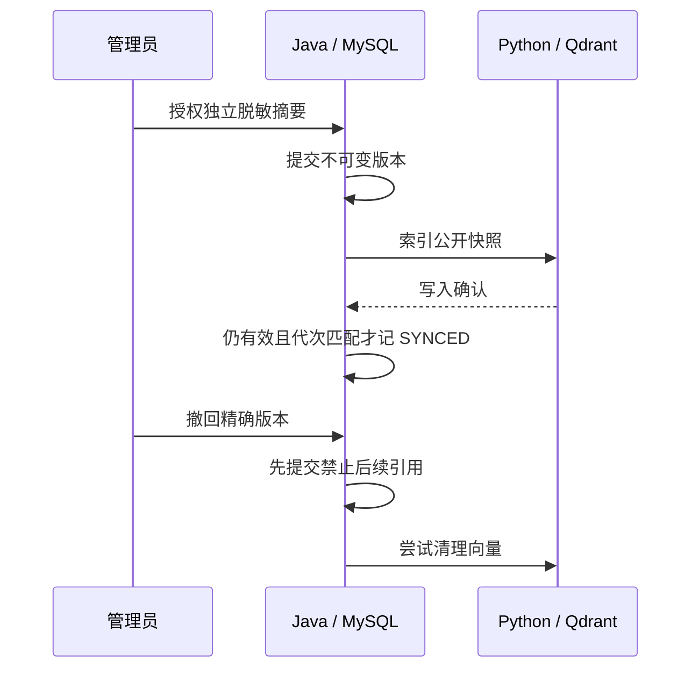

# ServiceFlow AI：源码审查与面试讲解

本指南对应已交付的 v0.10.0。先按 [Demo](DEMO.md) 复现，再结合 [模块导航](MODULES.md) 阅读源码。以下表述以实际代码和验证为依据；正式使用前，确认自己能解释并复现相应路径。

## 可以写进项目描述的能力

- 使用 Spring Boot、MyBatis、MySQL 与 Redis 实现售后工单状态机、四类角色与数据范围、显式客户确认、版本冲突控制及可撤销会话；Java 统一管理业务写入，Python 不持有业务数据库凭据。
- 通过独立 FastAPI/LangGraph 服务接入真实多语言 Embedding 与 Qdrant；知识经人工审核、独立脱敏授权后以不可变来源版本发布，检索按请求白名单校验，支持撤回、索引核验和同版本修复。
- 实现按团队负载分派、SLA 客户等待累计补偿、风险处置队列、事务审计及通知 outbox；使用真实 MySQL/Redis 集成测试、浏览器合同与业务闭环测试、Docker Compose 和 GitHub Actions 验证工程边界。

无模型 Key 时，系统为 retrieval_only，只返回真实检索摘录。远端 LLM 回答与 Tool Calling 质量尚未验收，不能写成“真实模型已全面通过”“高准确率”或“已上线生产”。

## 故事一：向量写入成功，不等于知识可被引用

**业务问题：** 内部知识审核通过，不代表可以向所有客户展示。向量还可能丢失、被篡改或清理失败。

**设计：** 管理员另填脱敏摘要并双确认，MySQL 保存 UUID/版本与授权状态。外部索引调用在事务外；只有 ACTIVE 且 SYNCED 的快照进入请求白名单。Python 逐字段核对 payload、版本与模型身份；Java 在回答落库、历史读取和旧草稿执行时再验证授权。

撤回先在数据库生效，再尽力删除向量。operation_revision 只用于阻止迟到的核验结果覆盖新修复，不能授予公开权限。迟到索引不能恢复撤回版本；清理失败也不能让残留向量被引用。

**读代码：** [PublicationService](../backend/src/main/java/com/serviceflow/collaboration/PublicationService.java)、[Python retrieval](../ai-service/serviceflow_ai/retrieval.py)、[PublicationIndexOperations](../backend/src/main/java/com/serviceflow/collaboration/PublicationIndexOperations.java)。

**证据：** [发布验证](KNOWLEDGE_PUBLICATION_RESULTS.md)、[真实丢失与修复](INDEX_OPERATIONS_RESULTS.md)、KnowledgePublicationIntegrationTest 和 test_real_publication。

**取舍：** 没有跨 MySQL/Qdrant 的原子事务。当前为人工逐版本核验与修复，没有持续监控、自动重试或物理擦除保证；已展示或发送给模型的内容不能收回。

## 故事二：等待客户时，SLA 到底暂停了什么

**业务问题：** 只暂停超时扫描、恢复后仍沿用旧截止时间，会把等待客户的时间算进客服处理时间。

**设计：** 进入 WAITING_CUSTOMER 记录暂停起点；离开到 IN_PROGRESS 或 CLOSED 时，以非负微秒差累计并顺延解决截止。工单版本更新、SLA 结算、事件、审计和 outbox 同事务。先更新/锁工单，再锁 SLA，扫描采用相同锁顺序。两个并发客户请求只有一次状态转换和补偿成功。

首次响应截止不暂停；进入等待前已超时的处理余额不会被抹除。既有等待从迁移时刻开始记录，不补造未记录的历史时长。时钟倒退补偿为零。

**读代码：** [TicketService](../backend/src/main/java/com/serviceflow/ticket/TicketService.java)、[OperationsService](../backend/src/main/java/com/serviceflow/operations/OperationsService.java)、[SlaInboxService](../backend/src/main/java/com/serviceflow/operations/SlaInboxService.java)。

**证据：** [SLA 验证](SLA_WORKBENCH_RESULTS.md)、[SlaInboxIntegrationTest](../backend/src/test/java/com/serviceflow/SlaInboxIntegrationTest.java)，包含多轮暂停、回滚、并发和日期边界。截止表达式保持原生 DATETIME，真实 MySQL 测试发现并修复了字符串哨兵破坏“截止瞬间”比较的问题。

**取舍：** 当前是 UTC 的自然时间 SLA，没有工作日历、跨时区排班或多级策略。风险队列是同一快照、同一 asOf 的读取结果，不是实时推送。

## 故事三：后端已经幂等，为什么前端仍需要处理迟到响应

**业务问题：** 建单成功后，较早开始的历史查询可能晚返回，把界面重新显示为待确认；反过来，历史已经遮蔽撤回来源后，较晚的建单或来源预览回包也可能重新显示旧正文。

**设计：** 客户端只缓存确认过的 run→ticket 关联（最多50条、随组件销毁），完成状态保持单调；内容使用最新安全历史，历史遗漏时只显示无引用、无提案的完成提示。来源预览的成功和错误回包均核对请求代次、当前 run 与当前引用集合。

客户端缓存不是权限来源。真实幂等、所有者权限、提案到期及撤回约束仍由 Java 校验。

**读代码与证据：** [AiAssist](../frontend/src/components/AiAssist.vue)、[四项门闩回归](../frontend/e2e/ai-contract.spec.ts)、[提案执行决策](adr/0003-agent-proposal-execution.md)。先用门闩固定返回顺序复现，再修复；首次远程失败记录保留在 GitHub。

## 如何说明测试可信度

| 验证 | 能证明 | 不能据此声称 |
| --- | --- | --- |
| Java 109项，真实MySQL/Redis | 权限、事务、并发、状态及API行为 | 生产性能、代码覆盖率 |
| Python 40项，含真实Embedding/Qdrant | 合同、真实向量写入/查询/过滤/删除 | 远端LLM质量或生产召回率 |
| Playwright 45项 | 界面合同、导航与一个真实多角色工单闭环 | 所有场景均调用真实模型 |
| 本地真实跨服务演练 | 发布/撤回/恢复、SLA等待补偿等指定流程 | 生产部署、全面容灾或安全认证 |
| PR与main三项CI | 对应固定提交的自动构建及回归 | 未运行场景也已通过 |

Python40项在v0.8执行；v0.9/v0.10未改Python源码，CI再次运行其离线合同。测试项数不是覆盖率。详细命令、失败与重跑结果见各版本报告和 Release 附件。

## 下一阶段

[AI运行观测](AI_OPERATIONS_RESULTS.md) 已交付：管理员查看白名单历史元数据，健康核验采用3秒等待与4KB响应上限；历史调用统计不代表当前授权或模型质量。配置真实模型 Key 后，按 [模型验收](LLM_ACCEPTANCE.md) 执行六场景评测，记录真实结果，再讨论回答质量改进。
